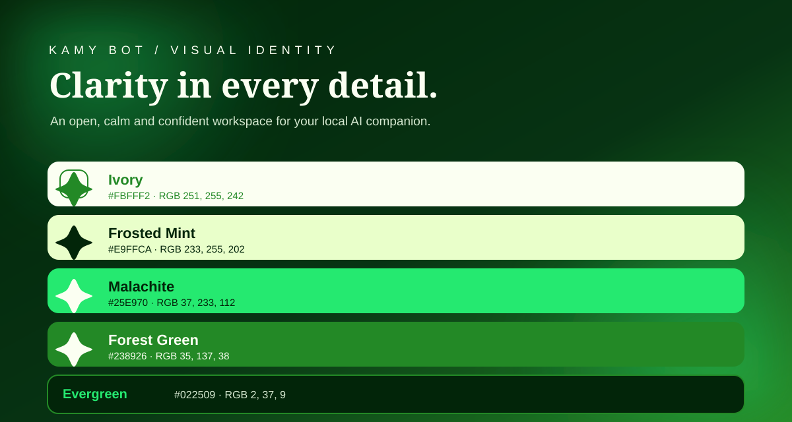

  
  <h1>KAMY BOT</h1>
  
<strong>Seu espaço local de trabalho com IA.</strong>

  
Um aplicativo open source, individual e local-first. Seus coworkers, credenciais, Skills, MCPs, conexões e arquivos ficam na sua própria máquina.

  
  
<a href="#instalação">Instalação</a> · <a href="#configurações">Configurações</a> · <a href="#segurança">Segurança</a> · <a href="LICENSE">MIT License</a>

---

## O que é

Kamy Bot é um aplicativo de desktop/local acessado pelo navegador. Você baixa e executa uma única instalação no seu próprio computador. **Não é SaaS, não é multiusuário, não conecta instalações entre si e não possui painel administrativo ou camada de operador.**

Cada instalação mantém seus próprios dados SQLite, workspaces, chaves de API, integrações, Skills, servidores MCP e configurações. O backend local usa FastAPI/Python e a interface é servida em localhost.

## Identidade visual

A identidade segue a paleta Malachite:

| Cor | HEX | Uso |
|---|---|---|
| Ivory | **#FBFFF2** | Texto principal e superfícies claras |
| Frosted Mint | **#E9FFCA** | Texto de destaque e superfícies suaves |
| Malachite | **#25E970** | Ações, foco e realces |
| Forest Green | **#238926** | Bordas, estados e superfícies |
| Evergreen | **#022509** | Fundo e identidade escura |

O mascote foi redesenhado como uma estrela de quatro pontas, inspirado no símbolo da referência visual. Os vetores oficiais ficam em assets/kamy-mascot.svg e assets/kamy-mark.svg.

## Recursos

- **Coworkers:** NOVA, PIXEL, SCOUT e coworkers personalizados, cada um com conversa e workspace local separado.
- **NVIDIA NIM:** chat compatível com Chat Completions, chave padrão criptografada ou chave individual por coworker e modelo configurável.
- **Settings:** tamanho do texto, alto contraste, espaçamento, redução de movimento, provedor NVIDIA, modelo, chaves individuais e diagnóstico do runtime.
- **Audit trail:** registro de propostas, aprovações, rejeições, execuções e bloqueios.
- **Permissions:** ferramentas e domínios permitidos por coworker; a política é revalidada antes de executar a ação.
- **Skills:** importar e revisar instruções declarativas SKILL.md, habilitar, desabilitar e excluir.
- **MCP:** cadastro de servidores Streamable HTTP e STDIO, descoberta de ferramentas, permissão individual e chamada sujeita a aprovação.
- **OAuth:** Authorization Code + PKCE para provedores HTTP MCP compatíveis. Tokens e segredos são criptografados localmente.
- **Finance / Binance:** cotação Spot pública, consulta privada de saldos e ordens de teste ou reais com confirmação explícita.
- **Kamy Intel:** casos locais e registro de evidências, fontes, URLs e datas observadas.

### Limites funcionais importantes

- O modelo só responde com NVIDIA depois que você configura uma chave válida.
- O runtime nativo não habilita Playwright/Chromium. Para automação de navegador use Docker com --docker.
- O MCP STDIO executa localmente o comando que você cadastrou, com as permissões do seu sistema. Revise o binário e os argumentos.
- Skills são instruções em Markdown. O conteúdo importado não é executado como programa.
- OAuth não configura a Binance. A integração Binance é independente.
- Ordens reais da Binance podem causar perdas financeiras. Use Testnet primeiro e uma API key sem permissão de saque.
- Kamy Intel registra e organiza evidências. Pesquisa automática na Internet depende de um MCP ou provedor configurado.

## Instalação

### Requisitos

- Node.js 18 ou superior.
- Python 3.11 ou superior.
- Conexão com a Internet na primeira instalação, para baixar as dependências Python.
- Docker Engine/Desktop somente para o modo com navegador isolado.

### Inicialização rápida

Depois que o pacote kamy-bot estiver publicado no registro npm, use o próprio npm para baixar, preparar e iniciar o aplicativo em uma única chamada:

~~~bash
npm exec --yes --package=kamy-bot -- kamy-bot
~~~

Na primeira execução, o comando prepara automaticamente:

1. A pasta pessoal ~/.kamy-bot/app (ou o caminho definido em KAMY_HOME).
2. O ambiente virtual Python .venv.
3. O arquivo privado .env, com uma chave Fernet gerada localmente.
4. As dependências de requirements.txt.
5. O banco SQLite e a pasta data/.
6. O servidor local e a abertura do navegador em http://127.0.0.1:8765.

Nas próximas execuções, o CLI verifica a versão das dependências e atualiza o código do aplicativo sem substituir .env, .venv ou os dados do usuário.

> **Publicação npm:** o launcher, o manifesto package.json e os arquivos do aplicativo já estão neste repositório. O comando acima só baixa o pacote quando a versão estiver publicada no registro npm. O código no GitHub, por si só, não publica o pacote. Até a publicação, teste pelo clone:

~~~bash
git clone https://github.com/stylesxzz/Kamy-Bot.git
cd Kamy-Bot
node ./bin/kamy-bot.js
~~~

### Docker com navegador isolado

Em computadores com Docker instalado e iniciado:

~~~bash
npm exec --yes --package=kamy-bot -- kamy-bot --docker
~~~

O modo Docker constrói a imagem Playwright, inicia Chromium no container e persiste os dados no volume kamy_data. O Docker **não é instalado automaticamente** pelo CLI, pois isso exige permissões administrativas e varia por sistema operacional. Instale e inicie o Docker Desktop/Engine antes de usar esta opção.

### Opções do CLI

| Comando | Comportamento |
|---|---|
| npm exec --yes --package=kamy-bot -- kamy-bot | Prepara o ambiente Python e inicia o modo local |
| npm exec --yes --package=kamy-bot -- kamy-bot --docker | Inicia com Docker e browser Playwright |
| npm exec --yes --package=kamy-bot -- kamy-bot --no-open | Inicia sem abrir o navegador |
| npm exec --yes --package=kamy-bot -- kamy-bot --port 9000 | Usa outra porta local |
| npm exec --yes --package=kamy-bot -- kamy-bot --help | Mostra a ajuda |

### Sistemas operacionais

**Linux (Debian/Kali/Ubuntu):** instale Node.js 18+ e Python 3.11+. Depois da publicação no npm, execute o comando npm exec acima. Para o modo Docker, instale Docker Engine com o plugin Compose.

**Windows:** instale Node.js 18+ e Python 3.11+. No PowerShell, execute node .\bin\kamy-bot.js depois de clonar o repositório. O CLI usa o launcher py -3 quando disponível.

**macOS:** instale Node.js 18+ e Python 3.11+. No Terminal, execute o comando npm exec acima. Docker Desktop é opcional.

**Android / Termux:** instale Termux de uma fonte oficial, depois execute pkg update -y && pkg install -y nodejs-lts python. Após a publicação do pacote, rode o comando npm exec acima. O modo nativo funciona sem Playwright; Docker não é suportado como requisito do fluxo Termux.

## Configurações

Abra **Settings** na barra lateral:

- **Interface:** escala do texto, alto contraste, espaçamento compacto e redução de animações. As preferências visuais são armazenadas localmente no navegador.
- **NVIDIA NIM:** modelo padrão e chave global cifrada com a chave mestra local. Coworkers sem chave própria usam o provedor padrão.
- **Por coworker:** modelo e chave individual. Uma chave individual tem prioridade sobre a chave global.
- **Runtime:** endereço/porta, pasta de dados, disponibilidade do Playwright e estado da chave mestra.
- **Integrações:** atalhos para Extensions e Permissions. Configure Skills, MCP, OAuth e Finance nas telas correspondentes.

As credenciais nunca são devolvidas à interface após serem salvas. Para remover uma chave, use a opção explícita de remoção.

## Estrutura e dados locais

~~~text
~/.kamy-bot/
└── app/
    ├── .env                  # chave mestra e opções locais
    ├── .venv/                # ambiente virtual Python
    ├── app.py
    ├── extensions.py
    ├── security.py
    ├── requirements.txt
    ├── static/               # interface, estilos e scripts
    ├── assets/               # marca e mascote SVG
    └── data/                 # bancos SQLite e workspaces
~~~

KAMY_HOME altera a pasta de instalação. KAMY_DATA_DIR é definido pelo launcher para a pasta de dados da instalação. Mantenha .env em backup seguro: perder KAMY_MASTER_KEY pode tornar credenciais criptografadas irrecuperáveis.

## Segurança

- O servidor permanece vinculado a 127.0.0.1 por padrão e rejeita solicitações remotas.
- Não exponha a porta local à Internet.
- Chaves de provedor, OAuth e Binance são armazenadas criptografadas usando Fernet e KAMY_MASTER_KEY.
- Não compartilhe o arquivo .env, bancos locais ou diretórios de workspace.
- Conceda apenas ferramentas MCP necessárias e revise cada execução.
- Servidores MCP STDIO são programas locais; a escolha do comando é uma decisão de confiança.
- A aprovação não ignora os limites de workspace, domínio ou ferramentas.

## Desenvolvimento e validação

~~~bash
python3 -m venv .venv
source .venv/bin/activate
python -m pip install --upgrade pip
pip install -r requirements.txt
pytest -q
node --check bin/kamy-bot.js
node --check static/app.js
node --check static/settings.js
node --check static/extensions.js
~~~

No Windows, ative o ambiente com .venv\Scripts\Activate.ps1.

## Licença

Kamy Bot é distribuído sob a licença [MIT](LICENSE).
