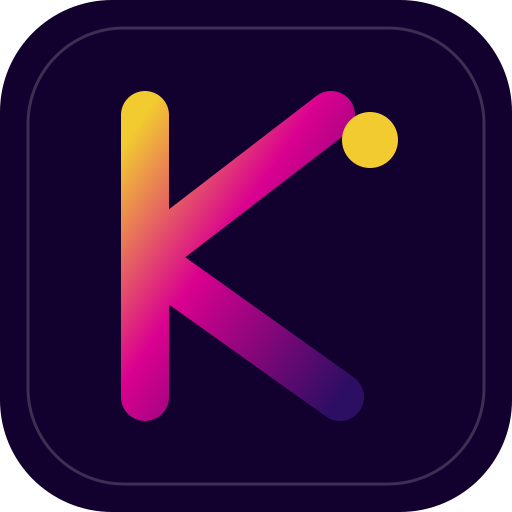

  
  <h1>KAMY BOT</h1>
  
<strong>Um espaço de trabalho de IA com agentes especializados, ferramentas e automações supervisionadas.</strong>

  
Seu ambiente de coworkers de IA: organize tarefas, converse com agentes independentes, conecte modelos e ferramentas externas e acompanhe ações com controle e auditoria.

  
  
<a href="https://github.com/stylesxzz/Kamy-Bot">Repositório</a> · <a href="https://build.nvidia.com/">NVIDIA API Catalog</a> · <a href="https://docs.api.nvidia.com/nim/reference/llm-apis">Documentação NVIDIA NIM</a>

# O que é o Kamy Bot?

O **Kamy Bot** é uma plataforma de coworkers de inteligência artificial que pode ser hospedada pelo próprio usuário. Em vez de ser apenas um chatbot que responde mensagens, ele foi concebido como um ambiente de trabalho no qual diferentes agentes de IA podem receber tarefas, manter conversas e configurações próprias, utilizar ferramentas autorizadas e organizar arquivos em espaços separados.

A ideia central é reunir, em um só lugar, assistência inteligente, automação supervisionada e integrações externas. O usuário conversa com os agentes pela interface web, configura o provedor de IA, define quais ferramentas e domínios podem ser utilizados e acompanha as ações que precisam de aprovação.

O Kamy Bot é um projeto modular e expansível. Sua arquitetura inicial já oferece a base de coworkers, interface web, integração com NVIDIA NIM, automação de navegador opcional, espaços de trabalho individuais e um fluxo de aprovação. Uma camada de extensões está sendo adicionada para Skills, servidores MCP, OAuth, propostas financeiras e organização de pesquisas.

> **Em poucas palavras:** Kamy Bot é um ambiente de trabalho de IA que transforma modelos de linguagem em coworkers configuráveis, com ferramentas, contexto de trabalho e limites definidos pelo usuário.

# O que ele faz?

- Permite conversar com diferentes coworkers de IA em canais independentes.
- Permite criar e configurar agentes adicionais.
- Conecta os agentes a modelos de IA compatíveis, incluindo NVIDIA NIM.
- Mantém configurações e históricos de conversa no ambiente hospedado.
- Oferece espaços de arquivos separados por agente.
- Pode utilizar navegador automatizado com Playwright quando executado no modo Docker com navegador habilitado.
- Coloca ações compatíveis de navegador e arquivos em uma fila de aprovação antes da execução.
- Aplica regras de ferramentas permitidas, domínios aprovados e caminhos de arquivos autorizados.
- Registra propostas, decisões e resultados para auditoria.
- Está recebendo uma camada modular para cadastrar Skills, servidores MCP e provedores OAuth.
- Inclui uma base inicial para registrar propostas de investimento e organizar pesquisas com fontes públicas.

# Os coworkers

A instalação inicial apresenta três coworkers:

| Coworker | Como funciona |
|---|---|
| **NOVA** | Um coworker independente, com canal, configuração, contexto de navegador e espaço de arquivos próprios. |
| **PIXEL** | Outro coworker independente, com seu próprio ambiente e histórico de trabalho. |
| **SCOUT** | Um terceiro coworker independente, também configurável e isolado dos demais no nível de contexto e workspace. |

Os nomes identificam coworkers separados dentro do sistema. Cada um pode receber suas próprias instruções, modelo, credenciais de provedor, ferramentas permitidas e domínios aprovados. O usuário também pode criar outros coworkers.

A especialização exata de cada coworker depende das instruções e ferramentas que forem configuradas. Os nomes, por si só, não significam que exista um conjunto fixo de competências autônomas já implementado.

# Como o Kamy Bot funciona

A arquitetura pode ser entendida em etapas:

1. **Interface web:** o usuário abre o Kamy Bot no navegador e escolhe um coworker.
2. **Agente:** a aplicação carrega as configurações e o histórico daquele coworker.
3. **Modelo de IA:** o backend envia a conversa ao provedor configurado, como NVIDIA NIM.
4. **Planejamento e ferramentas:** quando aplicável, o agente prepara uma ação compatível com as ferramentas habilitadas.
5. **Políticas e aprovação:** a aplicação verifica as regras e, para ações sujeitas a aprovação, aguarda uma decisão explícita do usuário.
6. **Execução:** somente ações aprovadas e suportadas pelo sistema são executadas.
7. **Persistência e auditoria:** conversas, configurações, propostas e eventos relevantes são armazenados no banco de dados.

## Visão simplificada da arquitetura

~~~text
                  USUÁRIO
                     |
                     v
              INTERFACE WEB
                     |
                     v
              BACKEND FASTAPI
                     |
          +----------+-----------+
          |          |           |
          v          v           v
      COWORKERS   MODELOS IA   POLÍTICAS
      NOVA        NVIDIA NIM   Aprovações
      PIXEL       compatíveis  Domínios
      SCOUT                    Ferramentas
          |          |           |
          +----------+-----------+
                     |
           +---------+----------+
           |         |          |
           v         v          v
        BROWSER   WORKSPACES   SQLITE
       Playwright  por agente  Histórico
                              Auditoria
                     |
                     v
              CAMADA DE EXTENSÕES
          Skills · MCP · OAuth · Finance
                    · Kamy Intel
~~~

# Principais módulos

## 1. Coworkers e conversas

Cada coworker possui um canal de conversa e configurações próprias. É possível configurar o modelo, o provedor, as instruções e as ferramentas permitidas. O objetivo é permitir que diferentes agentes trabalhem em tarefas diferentes sem misturar seus históricos e espaços de arquivos.

## 2. Inteligência artificial e NVIDIA NIM

O Kamy Bot pode se conectar ao endpoint compatível com OpenAI da NVIDIA NIM:

- Endpoint padrão: `https://integrate.api.nvidia.com/v1/chat/completions`
- Autenticação: chave de API NVIDIA.
- Modelo padrão documentado: `meta/llama-3.3-70b-instruct`.

O modelo é o mecanismo que interpreta as mensagens e gera respostas. As ferramentas e permissões disponíveis ao agente são controladas pela aplicação, não pelo modelo sozinho.

Documentação: [NVIDIA NIM](https://docs.api.nvidia.com/nim/reference/llm-apis) · [NVIDIA API Catalog](https://build.nvidia.com/).

## 3. Navegador e automação supervisionada

Quando o modo de navegador está habilitado, o Kamy Bot utiliza Playwright e Chromium. Os coworkers mantêm contextos de navegador separados, incluindo armazenamento de sessão e cookies.

As ações compatíveis passam por políticas de segurança. Ações que exigem aprovação são apresentadas ao usuário para aceitar ou rejeitar antes da execução.

O contexto separado de navegador não equivale a isolamento completo por sistema operacional. O projeto é um MVP self-hosted, não um sandbox multiusuário endurecido.

## 4. Workspaces e arquivos

Cada coworker possui um diretório de trabalho próprio dentro de `KAMY_DATA_DIR/workspaces/<agent-id>`. Isso permite organizar arquivos por agente e evitar que todos os coworkers compartilhem o mesmo espaço de trabalho por padrão.

## 5. Aprovações, políticas e auditoria

O sistema possui uma camada de controle para ações suportadas:

- Lista de ferramentas permitidas.
- Lista de domínios aprovados.
- Validação de URLs e caminhos de workspace.
- Aprovação ou rejeição de ações propostas.
- Registro de propostas, decisões e resultados no SQLite.

A aprovação humana reduz o risco de ações indesejadas, mas não substitui autenticação, isolamento de rede ou proteção do servidor.

# Camada de extensões

A camada de extensões amplia o Kamy Bot sem substituir os coworkers e recursos originais. Ela foi iniciada como uma API modular e ainda não deve ser confundida com uma loja visual de extensões ou com um executor universal de ferramentas.

## 6. Skills — habilidades instaláveis

Skills são conjuntos de instruções que ensinam o agente a seguir procedimentos para determinadas tarefas. Exemplos de habilidades que podem ser documentadas:

- Análise de mercado e educação financeira.
- Organização de pesquisas e relatórios.
- Desenvolvimento e revisão de código.
- Análise de dados.
- Organização de tarefas e documentação.

A API inicial permite cadastrar uma Skill em formato declarativo, revisar, habilitar e desabilitar. Conteúdo externo não deve ser tratado como confiável automaticamente. Nesta versão, o instalador aceita instruções em Markdown e não executa scripts baixados.

## 7. MCP — conexão com ferramentas externas

MCP (Model Context Protocol) é um protocolo para conectar aplicações de IA a ferramentas e fontes de contexto externas.

A camada inicial do Kamy Bot permite registrar configurações de servidores MCP nos transportes:

- Streamable HTTP.
- SSE.
- STDIO.

O cadastro não significa que o servidor já esteja conectado e executando ferramentas: o runtime cliente MCP, descoberta de ferramentas, gestão de permissões por ferramenta e execução ainda precisam ser implementados. Comandos STDIO cadastrados não são iniciados automaticamente.

A direção planejada é permitir que o usuário conecte serviços externos, veja quais ferramentas cada servidor oferece e autorize individualmente o que cada coworker pode utilizar.

## 8. OAuth — autorização de contas externas

OAuth é um padrão de autorização que permite ao usuário conceder acesso limitado a uma aplicação sem entregar a ela sua senha do serviço externo.

A camada inicial oferece cadastro de provedores, início do fluxo Authorization Code com PKCE S256, callback e armazenamento criptografado de tokens, usando uma chave mestra configurada no ambiente.

O fluxo depende do suporte e da configuração de cada provedor. É necessário cadastrar URLs oficiais, identificador do aplicativo, callback e escopos permitidos. Renovação e revogação de tokens, descoberta automática de provedores e conectores específicos ainda precisam ser concluídos.

**O Kamy Bot não deve pedir a senha da conta externa, contornar MFA ou automatizar login por meio de captura de credenciais.** A autorização deve ocorrer na página oficial do provedor, com consentimento explícito do usuário.

## 9. Finance — investimentos e informações financeiras

O objetivo do módulo Finance é permitir que o Kamy Bot ajude o usuário a estudar investimentos, organizar informações e preparar propostas de operações.

Possíveis capacidades futuras:

- Consultar dados financeiros por APIs oficiais.
- Comparar ativos, custos, riscos e indicadores.
- Organizar carteira e histórico fornecidos pelo usuário.
- Produzir análises e relatórios.
- Preparar propostas de compra e venda.
- Integrar provedores financeiros que ofereçam APIs autorizadas.

A implementação atual possui uma base de registro de propostas de ordens, com estados de revisão e aprovação. **Ela não envia ordens reais a corretoras.** A rota de execução está deliberadamente bloqueada até que existam adaptadores oficiais por instituição, controles de risco, idempotência e confirmação final.

Não existe conexão universal com qualquer banco ou corretora. Cada instituição possui APIs, permissões e requisitos próprios. Análises produzidas por IA não são garantia de retorno nem substituem avaliação financeira independente.

## 10. Kamy Intel — pesquisa e organização de evidências

O módulo Kamy Intel foi concebido para ajudar a organizar investigações e pesquisas com fontes verificáveis.

Exemplos de uso legítimo:

- Pesquisar informações publicamente disponíveis.
- Organizar referências e links.
- Registrar datas, trechos e origem das informações.
- Montar uma linha do tempo baseada em evidências.
- Preparar relatórios com distinção entre fatos confirmados e hipóteses.
- Consultar APIs oficiais com autorização e escopos adequados.

A base inicial permite criar casos e anexar evidências com URLs HTTPS, trechos e datas. Ela é um registro de evidências, não um mecanismo automático de busca em todas as redes sociais.

Conectores de redes sociais precisam ser desenvolvidos individualmente, respeitando as APIs oficiais, permissões, termos de uso e privacidade. O sistema não deve acessar contas privadas sem autorização, coletar credenciais, perseguir pessoas ou expor dados pessoais indevidamente.

# O que está implementado e o que está planejado?

| Recurso | Situação documentada |
|---|---|
| Interface web responsiva | Implementada |
| Coworkers NOVA, PIXEL e SCOUT | Implementados |
| Criação e configuração de coworkers | Implementada |
| Integração NVIDIA NIM | Implementada |
| Contextos de navegador por coworker | Implementados no modo compatível |
| Aprovação de ações suportadas | Implementada |
| Workspaces por agente | Implementados |
| Persistência SQLite e auditoria | Implementadas |
| Cadastro e revisão de Skills declarativas | API inicial implementada |
| Cadastro de servidores MCP | Registro inicial implementado |
| Runtime universal para executar ferramentas MCP | Planejado |
| OAuth Authorization Code + PKCE | Fluxo inicial implementado |
| Renovação e revogação OAuth por provedor | Pendente |
| Registro de propostas financeiras | API inicial implementada |
| Envio de ordens reais a corretoras | Desabilitado / pendente |
| Registro de casos e evidências Kamy Intel | API inicial implementada |
| Conectores automáticos de redes sociais | Pendente |
| Marketplace visual de Skills e MCP | Planejado |

# Instalação e execução

O Kamy Bot foi estruturado para execução self-hosted. O método recomendado é Docker Compose em Windows, macOS ou Linux. Também existe um modo Python nativo sem automação de navegador, útil em ambientes como Termux com Debian via proot.

## Docker — instalação rápida

~~~bash
git clone https://github.com/stylesxzz/Kamy-Bot.git
cd Kamy-Bot
cp .env.example .env
docker compose up --build -d
~~~

Abra no navegador:

`http://localhost:8000`

Para acompanhar:

~~~bash
docker compose logs -f kamy-bot
~~~

Para parar:

~~~bash
docker compose down
~~~

Consulte as instruções completas por sistema operacional neste README e os arquivos de configuração do projeto antes de instalar em produção.

# Dados, privacidade e segurança

O Kamy Bot é self-hosted: o usuário administra o ambiente onde a aplicação e seus dados são executados. Isso não significa que toda informação fique necessariamente offline. Quando um coworker utiliza um provedor remoto, como NVIDIA NIM, as mensagens necessárias à geração da resposta são enviadas ao serviço correspondente.

Cuidados importantes:

- Proteja o diretório de dados e o volume Docker.
- Não envie arquivos `.env`, chaves de API, tokens ou senhas ao GitHub.
- Configure uma chave mestra forte e persistente para criptografia dos tokens OAuth.
- Use HTTPS e autenticação antes de expor o serviço fora de uma rede privada.
- Revise Skills e servidores MCP antes de confiar neles.
- Conceda apenas os escopos OAuth necessários.
- Mantenha operações financeiras reais bloqueadas até implementar controles e integrações específicos.
- Faça backups do banco de dados e dos workspaces.

O projeto ainda é um MVP em evolução. Antes de uma implantação pública ou multiusuário, são necessários controles adicionais como autenticação, proteção CSRF, limitação de requisições, filtragem de tráfego de saída e isolamento mais forte entre agentes.

# Tecnologias

- **Python** — lógica do backend.
- **FastAPI** — API HTTP.
- **SQLite** — persistência local.
- **Playwright / Chromium** — automação de navegador opcional.
- **NVIDIA NIM** — provedor de modelos de IA.
- **Docker / Docker Compose** — implantação recomendada.
- **HTML, CSS e JavaScript** — interface web.
- **OAuth 2.0 / PKCE** — autorização de serviços externos.
- **MCP** — protocolo de integração planejado para ferramentas externas.

# Estrutura do projeto

~~~text
Kamy-Bot/
├── app.py
├── extensions.py
├── requirements.txt
├── requirements-browser.txt
├── Dockerfile
├── docker-compose.yml
├── .env.example
├── start.sh
├── start.bat
├── assets/
├── static/
├── tests/
└── .github/
    └── workflows/
~~~

# Filosofia do projeto

O Kamy Bot busca ser mais do que uma interface de chat. Sua proposta é criar um ambiente de trabalho de IA modular, no qual o usuário escolhe os agentes, configura os modelos, conecta ferramentas autorizadas, define limites e acompanha o que acontece.

A inteligência artificial ajuda a interpretar e executar tarefas, mas o usuário continua no controle das permissões, das conexões e das decisões importantes.

**Kamy Bot — seus coworkers de IA, suas ferramentas e seu ambiente de trabalho.**

# Licença

MIT. Consulte o arquivo [LICENSE](LICENSE).
