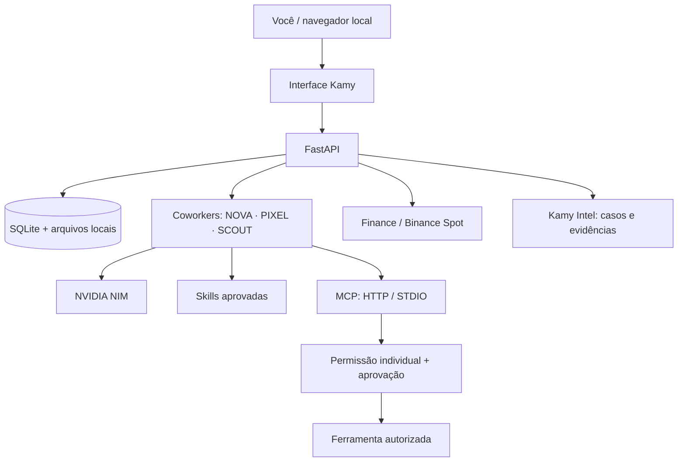

<div align="center">
  
  <h1>KAMY BOT</h1>
  <p><strong>Seu coworker de IA. Suas ferramentas. Seu ambiente local.</strong></p>
  <p>Aplicação open source, single-user e self-hosted para trabalhar com coworkers de IA, Skills, MCP, Finance e pesquisa com evidências.</p>
  <p>
    <a href="https://github.com/stylesxzz/Kamy-Bot">Repositório</a> ·
    <a href="#instalação">Instalação</a> ·
    <a href="#segurança-e-limitações">Segurança e limitações</a>
  </p>
  
</div>

---

## Índice

- [O que é](#o-que-é)
- [Recursos](#recursos)
- [Como as integrações funcionam](#como-as-integrações-funcionam)
- [Instalação](#instalação)
  - [Linux](#linux)
  - [Windows](#windows)
  - [macOS](#macos)
  - [Android / Termux](#android--termux)
- [Configuração](#configuração)
- [Operação e atualização](#operação-e-atualização)
- [Testes](#testes)
- [Segurança e limitações](#segurança-e-limitações)
- [Estrutura do projeto](#estrutura-do-projeto)

## O que é

Kamy Bot é um aplicativo pessoal executado na máquina do próprio usuário. Cada instalação tem seu próprio banco SQLite, arquivos, credenciais, coworkers, Skills e conexões. **Não é SaaS, não é multiusuário e não possui painel administrativo ou contas compartilhadas.**

A interface web é servida localmente e pode ser aberta pelo navegador do computador ou do próprio Android. O backend usa FastAPI/Python; os dados são mantidos no diretório local `data/` ou no volume Docker.

## Recursos

| Área | O que oferece | Limite importante |
|---|---|---|
| Coworkers | NOVA, PIXEL e SCOUT, conversas e workspaces separados; criação de outros agentes | O provedor de IA precisa ser configurado pelo usuário |
| NVIDIA NIM | Chat Completions compatível com a API OpenAI | Requer chave e modelo disponíveis na NVIDIA |
| Browser | Playwright/Chromium em instalação Docker | Desabilitado no modo nativo/Termux |
| Aprovação e auditoria | Ações pendentes, decisão explícita e histórico | Aprovação não deve ser usada para ignorar políticas |
| Skills | Importar `SKILL.md` do GitHub, revisar, habilitar, desabilitar e excluir | Skills são instruções Markdown; código baixado não é executado |
| MCP | Streamable HTTP e STDIO local, descoberta de ferramentas, permissões individuais e propostas com aprovação | SSE não está habilitado; HTTP remoto exige HTTPS e allowlist |
| OAuth | Authorization Code + PKCE, tokens locais criptografados e refresh quando o provedor oferece refresh token | OAuth é exclusivamente para conectar MCPs HTTP; não é usado pela Binance |
| Finance / Binance | Preço Spot público, consulta de saldos privados e ordens MARKET de teste ou reais com confirmação | Não há saque; ordens reais envolvem risco e exigem configuração explícita |
| Kamy Intel | Casos de investigação e registro de fontes, URLs, trechos e datas | Não inclui mecanismo universal de busca automática; conecte um MCP/provedor de pesquisa |

## Como as integrações funcionam

### Visão da arquitetura



### Skills

1. Importe um `SKILL.md` de uma URL HTTPS de `raw.githubusercontent.com` ou cadastre as instruções manualmente.
2. Leia e revise o conteúdo antes de habilitar.
3. Habilite a Skill para que as instruções aprovadas sejam incluídas no contexto dos coworkers.
4. Desabilite ou exclua quando não precisar mais.

Skills são declarativas. O Kamy rejeita alguns formatos óbvios de código executável e não executa scripts contidos em Skills.

### MCP e ferramentas

- **Streamable HTTP:** informe a URL HTTPS do servidor MCP. Para chamadas reais, adicione o hostname exato a `KAMY_MCP_ALLOWED_HOSTS`.
- **STDIO:** informe o executável e os argumentos de um servidor MCP instalado localmente. O processo é iniciado para descoberta ou chamada de ferramenta, sem shell intermediário.
- **Descoberta:** o Kamy consulta as ferramentas disponibilizadas pelo servidor e guarda seus nomes e schemas.
- **Permissão individual:** conceda ou revogue cada ferramenta separadamente.
- **Aprovação:** chamadas são propostas; a execução só acontece depois da aprovação explícita.
- **SSE:** o transporte SSE legado é armazenado como opção, mas não é suportado pelo runtime atual.

Só conecte servidores MCP de origem confiável. Um servidor STDIO executa um programa local com as permissões do usuário que iniciou o Kamy. Revise executável, argumentos e dependências antes de autorizar.

### OAuth — somente para MCP HTTP

Cadastre os endpoints oficiais do provedor, Client ID, Client Secret (quando necessário), Redirect URI e escopos. O fluxo usa Authorization Code + PKCE S256. Os tokens e segredos são criptografados com `KAMY_MASTER_KEY` e associados ao provedor MCP selecionado.

OAuth **não** é a autenticação da Binance e não é usado pelo módulo Intel. STDIO usa as credenciais locais do ambiente/processo.

### Finance — Binance

A Binance é uma integração direta com a API Spot, separada de OAuth e MCP:

- Salve API Key e Secret próprios na tela Finance; as credenciais são criptografadas localmente.
- Comece com Testnet.
- A consulta de preço Spot é pública; consulta de conta exige credenciais.
- Ordens MARKET de teste usam o endpoint de teste.
- Ordens MARKET reais exigem confirmação explícita na interface.
- Crie uma chave Binance com permissões mínimas e **saques desabilitados**.

Não há endpoints de saque implementados. O módulo não oferece Futures, Margin, Earn nem cobertura de todas as carteiras/produtos Binance. Uma ordem real pode causar perda financeira; revise ativo, lado, quantidade e ambiente antes de confirmar.

Documentação oficial: [Binance Spot REST API](https://developers.binance.com/en/docs/products/spot/rest-api).

### Kamy Intel

Crie um caso com a pergunta e a finalidade da investigação. Registre evidências HTTPS com título, trecho, data observada e tipo de fonte. Para encontrar conteúdo na Internet, use navegação autorizada ou conecte um MCP/provedor de busca. O Kamy organiza e preserva evidências, mas não promete busca universal sem um provedor configurado. Respeite privacidade, termos de uso e controles de acesso.

## Instalação

Escolha **um** método. Docker é recomendado em computadores para habilitar Playwright/Chromium. A instalação nativa é mais leve e também funciona em Android/Termux, mas não inclui automação de navegador.

### Linux

**Opção A — Docker (Debian/Ubuntu)**

1. Instale Git e Docker Engine com o plugin Compose seguindo o guia oficial da sua distribuição: [Docker Engine](https://docs.docker.com/engine/install/) e [Compose plugin](https://docs.docker.com/compose/install/linux/).
2. Depois que Docker e Compose estiverem instalados:

```bash
sudo apt update
sudo apt install -y git
git clone https://github.com/stylesxzz/Kamy-Bot.git
cd Kamy-Bot
cp .env.example .env
docker compose up --build -d
docker compose ps
```

Abra **http://127.0.0.1:8000**.

**Opção B — Python nativo (sem navegador)**

Requer Python 3.11+ e Git.

```bash
sudo apt update
sudo apt install -y git python3 python3-venv python3-pip
git clone https://github.com/stylesxzz/Kamy-Bot.git
cd Kamy-Bot
bash scripts/install.sh
bash scripts/start.sh
```

Abra **http://127.0.0.1:8765**. O instalador cria `.venv`, `.env` e uma chave Fernet local se ainda não existirem.

### Windows

**Opção A — Docker Desktop (recomendado)**

1. Instale [Git for Windows](https://git-scm.com/download/win).
2. Instale [Docker Desktop](https://docs.docker.com/desktop/setup/install/windows-install/) e aguarde o engine iniciar.
3. Abra PowerShell:

```powershell
git clone https://github.com/stylesxzz/Kamy-Bot.git
Set-Location Kamy-Bot
Copy-Item .env.example .env
docker compose up --build -d
docker compose ps
```

Abra **http://127.0.0.1:8000**.

**Opção B — Python nativo (sem navegador)**

Instale [Python 3.11 ou superior](https://www.python.org/downloads/windows/) e Git. No PowerShell:

```powershell
git clone https://github.com/stylesxzz/Kamy-Bot.git
Set-Location Kamy-Bot
powershell -ExecutionPolicy Bypass -File scripts/install.ps1
.\scripts\start.ps1
```

Abra **http://127.0.0.1:8765**. Se a política do PowerShell bloquear o script de início, execute `Set-ExecutionPolicy -Scope Process Bypass` na mesma janela e tente novamente.

### macOS

**Opção A — Docker Desktop (recomendado)**

1. Instale [Docker Desktop para Mac](https://docs.docker.com/desktop/setup/install/mac-install/).
2. Abra Docker Desktop e aguarde o engine iniciar.
3. No Terminal:

```bash
xcode-select --install
git clone https://github.com/stylesxzz/Kamy-Bot.git
cd Kamy-Bot
cp .env.example .env
docker compose up --build -d
docker compose ps
```

Abra **http://127.0.0.1:8000**.

**Opção B — Python nativo (sem navegador)**

Instale Python 3.11+ (por exemplo, [python.org](https://www.python.org/downloads/macos/)) e Git. No Terminal:

```bash
git clone https://github.com/stylesxzz/Kamy-Bot.git
cd Kamy-Bot
bash scripts/install.sh
bash scripts/start.sh
```

Abra **http://127.0.0.1:8765**.

### Android / Termux

O Android usa a instalação Python nativa. Docker/Playwright não são habilitados neste modo.

1. Instale Termux por uma fonte oficial/confiável: [Termux GitHub](https://github.com/termux/termux-app) ou [F-Droid](https://f-droid.org/packages/com.termux/). Não misture APKs de fontes diferentes.
2. Abra Termux e execute:

```bash
pkg update -y && pkg upgrade -y
pkg install -y git python clang rust
git clone https://github.com/stylesxzz/Kamy-Bot.git
cd Kamy-Bot
bash scripts/install-termux.sh
bash scripts/start.sh
```

3. Mantenha o Termux aberto e acesse **http://127.0.0.1:8765** no navegador do Android.

Para iniciar novamente em outra sessão:

```bash
cd ~/Kamy-Bot
bash scripts/start.sh
```

Para parar, volte ao Termux e pressione **CTRL+C**.

<details>
<summary>Alternativa: Debian via proot-distro</summary>

Se preferir um ambiente Debian dentro do Termux:

```bash
pkg update -y && pkg upgrade -y
pkg install -y git proot-distro
proot-distro install debian
proot-distro login debian
```

Dentro do Debian:

```bash
apt update
apt install -y git python3 python3-venv python3-pip build-essential
git clone https://github.com/stylesxzz/Kamy-Bot.git
cd Kamy-Bot
python3 -m venv .venv
. .venv/bin/activate
python -m pip install --upgrade pip
pip install -r requirements.txt
cp .env.example .env
```

Gere uma chave Fernet, configure-a em `.env` como `KAMY_MASTER_KEY`, e inicie:

```bash
export KAMY_BROWSER_ENABLED=0
export KAMY_DATA_DIR="$HOME/.local/share/kamy-bot"
python -m uvicorn app:app --host 127.0.0.1 --port 8765
```

</details>

## Configuração

### Chave mestra local

O instalador nativo gera uma chave Fernet automaticamente ao criar `.env`. No Docker, gere uma chave e preencha `KAMY_MASTER_KEY` no arquivo `.env`:

```bash
python -c "from cryptography.fernet import Fernet; print(Fernet.generate_key().decode())"
```

Mantenha essa chave em backup seguro. Ela protege chaves de API e tokens OAuth. Se for perdida ou trocada, os segredos criptografados existentes não poderão ser descriptografados.

### Variáveis principais

| Variável | Função |
|---|---|
| `KAMY_PORT` | Porta local; Docker usa 8000 e os scripts nativos usam 8765 por padrão |
| `KAMY_BIND` | Endereço publicado pelo Compose; mantenha `127.0.0.1` |
| `KAMY_BROWSER_ENABLED` | Ativa Playwright no Docker; use `0` no modo nativo/Termux |
| `KAMY_MASTER_KEY` | Chave Fernet para criptografia local |
| `KAMY_MCP_ALLOWED_HOSTS` | Lista separada por vírgulas de hostnames HTTPS exatos autorizados para MCP remoto |
| `KAMY_DATA_DIR` | Diretório persistente de dados no modo nativo; no Docker é `/data` |

Para NVIDIA NIM, obtenha uma chave no [NVIDIA API Catalog](https://build.nvidia.com/), selecione um modelo disponível e configure a chave no coworker correspondente. A chave é armazenada localmente criptografada.

## Operação e atualização

**Docker — Linux / Windows / macOS**

```bash
docker compose ps
docker compose logs -f kamy-bot
docker compose restart kamy-bot
docker compose down
docker compose up --build -d
```

**Nativo — Linux / macOS / Termux**

```bash
cd Kamy-Bot
git pull
bash scripts/install.sh
bash scripts/start.sh
```

No Termux, use `bash scripts/install-termux.sh` no lugar de `scripts/install.sh`.

**Nativo — Windows PowerShell**

```powershell
Set-Location Kamy-Bot
git pull
powershell -ExecutionPolicy Bypass -File scripts/install.ps1
.\scripts\start.ps1
```

O comando `docker compose down -v` apaga o volume do banco e os dados persistentes. Não o use para uma atualização normal.

## Testes

Com Python 3.11+ e dependências instaladas:

```bash
python -m compileall -q app.py extensions.py security.py tests
pytest -q
node --check static/app.js
node --check static/extensions.js
docker compose config -q
```

O GitHub Actions executa a suíte em Python 3.11 e 3.12, checa a sintaxe JavaScript e valida a configuração do Docker Compose.

## Segurança e limitações

- O Kamy é single-user e local-first. Não há autenticação multiusuário, login administrativo ou isolamento entre contas.
- Mantenha a interface vinculada a `127.0.0.1`. Não exponha diretamente a porta na Internet.
- Para acesso remoto, prefira VPN privada ou túnel autenticado e revise firewall, TLS e controles de acesso.
- Nunca envie `.env`, API keys, Client Secrets, tokens OAuth ou o diretório `data/` para o Git.
- Restrinja permissões das chaves Binance e mantenha saques desabilitados.
- Comece com Binance Testnet. Ordens reais podem causar perdas; confirme cada ordem com cuidado.
- MCP STDIO inicia executáveis locais com as permissões do usuário. Revise código, origem, argumentos e dependências.
- MCP HTTP remoto exige HTTPS e hostname explícito em `KAMY_MCP_ALLOWED_HOSTS`.
- Skills importadas não são sandbox de segurança; leia as instruções antes de habilitar.
- Intel registra evidências; não substitui validação independente das fontes.
- Termux/nativo não oferece automação de navegador Playwright nesta configuração.

O Kamy é um projeto open source em evolução. Uma CI verde valida os testes automatizados existentes, mas não equivale a auditoria de segurança, teste de todos os provedores OAuth/MCP ou garantia de operação financeira sem risco.

## Estrutura do projeto

```text
Kamy-Bot/
├── app.py                    # API FastAPI, coworkers, chat e browser
├── extensions.py             # Skills, MCP, OAuth, Binance e Intel
├── security.py               # Restrições de acesso local e headers
├── requirements.txt          # Dependências Python
├── Dockerfile
├── docker-compose.yml
├── .env.example
├── scripts/
│   ├── install.sh
│   ├── start.sh
│   ├── install.ps1
│   ├── start.ps1
│   └── install-termux.sh
├── assets/
│   ├── kamy-mascot.svg        # Mascote oficial
│   ├── kamy-mark.svg
│   └── brand-palette.svg      # Identidade visual
├── static/
│   ├── index.html
│   ├── app.js
│   ├── extensions.js
│   └── *.css
├── tests/
└── .github/workflows/ci.yml
```

## Licença

Licença MIT. Consulte [LICENSE](LICENSE).

<div align="center">
  
  <p><strong>KAMY BOT</strong><br>Seu ambiente. Suas ferramentas. Seu controle.</p>
</div>
