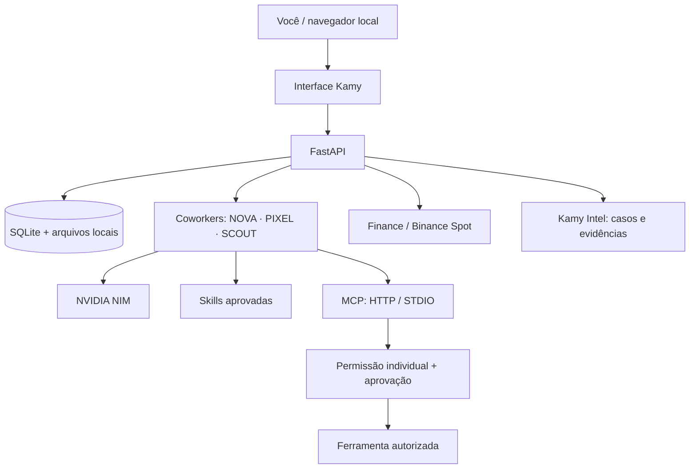
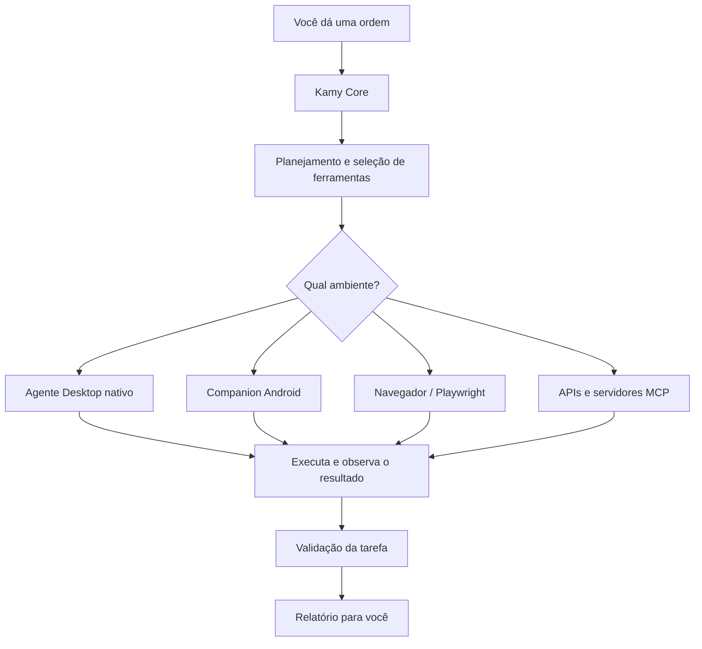

<div align="center">
  
  <h1>KAMY BOT</h1>
  <p><strong>Seu coworker de IA. Suas ferramentas. Seu ambiente local.</strong></p>
  <p>Aplicação open source, single-user e self-hosted para trabalhar com coworkers de IA, Skills, MCP, Finance e pesquisa com evidências.</p>
  <p>
    <a href="https://github.com/stylesxzz/Kamy-Bot">Repositório</a> ·
    <a href="#instalação">Instalação</a> ·
    <a href="#segurança-e-limitações">Segurança e limitações</a>
  </p>
  
</div>

---

## Índice

- [O que é](#o-que-é)
- [Recursos](#recursos)
- [Como as integrações funcionam](#como-as-integrações-funcionam)
- [Instalação](#instalação)
  - [Linux](#linux)
  - [Windows](#windows)
  - [macOS](#macos)
  - [Android / Termux](#android--termux)
- [Configuração](#configuração)
- [Operação e atualização](#operação-e-atualização)
- [Testes](#testes)
- [Segurança e limitações](#segurança-e-limitações)
- [Estrutura do projeto](#estrutura-do-projeto)

## O que é

Kamy Bot é um aplicativo pessoal executado na máquina do próprio usuário. Cada instalação tem seu próprio banco SQLite, arquivos, credenciais, coworkers, Skills e conexões. **Não é SaaS, não é multiusuário e não possui painel administrativo ou contas compartilhadas.**

A interface web é servida localmente e pode ser aberta pelo navegador do computador ou do próprio Android. O backend usa FastAPI/Python; os dados são mantidos no diretório local `data/` ou no volume Docker.

### Atualização do cockpit local

O cockpit atual organiza a experiência em quatro superfícies: **Coworkers**, **Audit trail**, **Permissions** e **Extensions**. NOVA, PIXEL, SCOUT e os agentes que você adicionar trabalham em workspaces separados. Cada agente pode ter um contexto Chromium próprio no Docker, uma área de arquivos delimitada e uma lista de ferramentas permitidas.

O fluxo de segurança é deliberadamente visível. O agente primeiro propõe a ação; a política é verificada novamente no momento da execução; só então a ação pode ser aprovada ou rejeitada. O resultado, incluindo bloqueios e erros, fica salvo em `actions` no SQLite. A tela de browser mostra o último estado do workspace e o histórico permite revisar o payload antes de decidir.

O Docker continua sendo o caminho recomendado quando o browser é necessário. A instalação nativa permanece adequada para chat, arquivos e Termux, com `KAMY_BROWSER_ENABLED=0` quando Chromium/Playwright não estiverem disponíveis. O mascote oficial continua sendo o elemento de marca do produto: ele aparece no README, na barra lateral e na área principal do cockpit em `assets/kamy-mascot.svg`; o símbolo reduzido permanece em `assets/kamy-mark.svg`.

## Recursos

| Área | O que oferece | Limite importante |
|---|---|---|
| Coworkers | NOVA, PIXEL e SCOUT, conversas e workspaces separados; criação de outros agentes | O provedor de IA precisa ser configurado pelo usuário |
| NVIDIA NIM | Chat Completions compatível com a API OpenAI | Requer chave e modelo disponíveis na NVIDIA |
| Browser | Playwright/Chromium em instalação Docker | Desabilitado no modo nativo/Termux |
| Aprovação e auditoria | Ações pendentes, decisão explícita e histórico | Aprovação não deve ser usada para ignorar políticas |
| Skills | Importar `SKILL.md` do GitHub, revisar, habilitar, desabilitar e excluir | Skills são instruções Markdown; código baixado não é executado |
| MCP | Streamable HTTP e STDIO local, descoberta de ferramentas, permissões individuais e propostas com aprovação | SSE não está habilitado; HTTP remoto exige HTTPS e allowlist |
| OAuth | Authorization Code + PKCE, tokens locais criptografados e refresh quando o provedor oferece refresh token | OAuth é exclusivamente para conectar MCPs HTTP; não é usado pela Binance |
| Finance / Binance | Preço Spot público, consulta de saldos privados e ordens MARKET de teste ou reais com confirmação | Não há saque; ordens reais envolvem risco e exigem configuração explícita |
| Kamy Intel | Casos de investigação e registro de fontes, URLs, trechos e datas | Não inclui mecanismo universal de busca automática; conecte um MCP/provedor de pesquisa |

## Como as integrações funcionam

### Visão da arquitetura



### Skills

1. Importe um `SKILL.md` de uma URL HTTPS de `raw.githubusercontent.com` ou cadastre as instruções manualmente.
2. Leia e revise o conteúdo antes de habilitar.
3. Habilite a Skill para que as instruções aprovadas sejam incluídas no contexto dos coworkers.
4. Desabilite ou exclua quando não precisar mais.

Skills são declarativas. O Kamy rejeita alguns formatos óbvios de código executável e não executa scripts contidos em Skills.

### MCP e ferramentas

- **Streamable HTTP:** informe a URL HTTPS do servidor MCP. Para chamadas reais, adicione o hostname exato a `KAMY_MCP_ALLOWED_HOSTS`.
- **STDIO:** informe o executável e os argumentos de um servidor MCP instalado localmente. O processo é iniciado para descoberta ou chamada de ferramenta, sem shell intermediário.
- **Descoberta:** o Kamy consulta as ferramentas disponibilizadas pelo servidor e guarda seus nomes e schemas.
- **Permissão individual:** conceda ou revogue cada ferramenta separadamente.
- **Aprovação:** chamadas são propostas; a execução só acontece depois da aprovação explícita.
- **SSE:** o transporte SSE legado é armazenado como opção, mas não é suportado pelo runtime atual.

Só conecte servidores MCP de origem confiável. Um servidor STDIO executa um programa local com as permissões do usuário que iniciou o Kamy. Revise executável, argumentos e dependências antes de autorizar.

### OAuth — somente para MCP HTTP

Cadastre os endpoints oficiais do provedor, Client ID, Client Secret (quando necessário), Redirect URI e escopos. O fluxo usa Authorization Code + PKCE S256. Os tokens e segredos são criptografados com `KAMY_MASTER_KEY` e associados ao provedor MCP selecionado.

OAuth **não** é a autenticação da Binance e não é usado pelo módulo Intel. STDIO usa as credenciais locais do ambiente/processo.

### Finance — Binance

A Binance é uma integração direta com a API Spot, separada de OAuth e MCP:

- Salve API Key e Secret próprios na tela Finance; as credenciais são criptografadas localmente.
- Comece com Testnet.
- A consulta de preço Spot é pública; consulta de conta exige credenciais.
- Ordens MARKET de teste usam o endpoint de teste.
- Ordens MARKET reais exigem confirmação explícita na interface.
- Crie uma chave Binance com permissões mínimas e **saques desabilitados**.

Não há endpoints de saque implementados. O módulo não oferece Futures, Margin, Earn nem cobertura de todas as carteiras/produtos Binance. Uma ordem real pode causar perda financeira; revise ativo, lado, quantidade e ambiente antes de confirmar.

Documentação oficial: [Binance Spot REST API](https://developers.binance.com/en/docs/products/spot/rest-api).

### Kamy Intel

Crie um caso com a pergunta e a finalidade da investigação. Registre evidências HTTPS com título, trecho, data observada e tipo de fonte. Para encontrar conteúdo na Internet, use navegação autorizada ou conecte um MCP/provedor de busca. O Kamy organiza e preserva evidências, mas não promete busca universal sem um provedor configurado. Respeite privacidade, termos de uso e controles de acesso.

## Instalação

Escolha **um** método. Docker é recomendado em computadores para habilitar Playwright/Chromium. A instalação nativa é mais leve e também funciona em Android/Termux, mas não inclui automação de navegador.

### Linux

**Opção A — Docker (Debian/Ubuntu)**

1. Instale Git e Docker Engine com o plugin Compose seguindo o guia oficial da sua distribuição: [Docker Engine](https://docs.docker.com/engine/install/) e [Compose plugin](https://docs.docker.com/compose/install/linux/).
2. Depois que Docker e Compose estiverem instalados:

```bash
sudo apt update
sudo apt install -y git
git clone https://github.com/stylesxzz/Kamy-Bot.git
cd Kamy-Bot
cp .env.example .env
docker compose up --build -d
docker compose ps
```

Abra **http://127.0.0.1:8000**.

**Opção B — Python nativo (sem navegador)**

Requer Python 3.11+ e Git.

```bash
sudo apt update
sudo apt install -y git python3 python3-venv python3-pip
git clone https://github.com/stylesxzz/Kamy-Bot.git
cd Kamy-Bot
bash scripts/install.sh
bash scripts/start.sh
```

Abra **http://127.0.0.1:8765**. O instalador cria `.venv`, `.env` e uma chave Fernet local se ainda não existirem.

### Windows

**Opção A — Docker Desktop (recomendado)**

1. Instale [Git for Windows](https://git-scm.com/download/win).
2. Instale [Docker Desktop](https://docs.docker.com/desktop/setup/install/windows-install/) e aguarde o engine iniciar.
3. Abra PowerShell:

```powershell
git clone https://github.com/stylesxzz/Kamy-Bot.git
Set-Location Kamy-Bot
Copy-Item .env.example .env
docker compose up --build -d
docker compose ps
```

Abra **http://127.0.0.1:8000**.

**Opção B — Python nativo (sem navegador)**

Instale [Python 3.11 ou superior](https://www.python.org/downloads/windows/) e Git. No PowerShell:

```powershell
git clone https://github.com/stylesxzz/Kamy-Bot.git
Set-Location Kamy-Bot
powershell -ExecutionPolicy Bypass -File scripts/install.ps1
.\scripts\start.ps1
```

Abra **http://127.0.0.1:8765**. Se a política do PowerShell bloquear o script de início, execute `Set-ExecutionPolicy -Scope Process Bypass` na mesma janela e tente novamente.

### macOS

**Opção A — Docker Desktop (recomendado)**

1. Instale [Docker Desktop para Mac](https://docs.docker.com/desktop/setup/install/mac-install/).
2. Abra Docker Desktop e aguarde o engine iniciar.
3. No Terminal:

```bash
xcode-select --install
git clone https://github.com/stylesxzz/Kamy-Bot.git
cd Kamy-Bot
cp .env.example .env
docker compose up --build -d
docker compose ps
```

Abra **http://127.0.0.1:8000**.

**Opção B — Python nativo (sem navegador)**

Instale Python 3.11+ (por exemplo, [python.org](https://www.python.org/downloads/macos/)) e Git. No Terminal:

```bash
git clone https://github.com/stylesxzz/Kamy-Bot.git
cd Kamy-Bot
bash scripts/install.sh
bash scripts/start.sh
```

Abra **http://127.0.0.1:8765**.

### Android / Termux

O Android usa a instalação Python nativa. Docker/Playwright não são habilitados neste modo.

1. Instale Termux por uma fonte oficial/confiável: [Termux GitHub](https://github.com/termux/termux-app) ou [F-Droid](https://f-droid.org/packages/com.termux/). Não misture APKs de fontes diferentes.
2. Abra Termux e execute:

```bash
pkg update -y && pkg upgrade -y
pkg install -y git python clang rust
git clone https://github.com/stylesxzz/Kamy-Bot.git
cd Kamy-Bot
bash scripts/install-termux.sh
bash scripts/start.sh
```

3. Mantenha o Termux aberto e acesse **http://127.0.0.1:8765** no navegador do Android.

Para iniciar novamente em outra sessão:

```bash
cd ~/Kamy-Bot
bash scripts/start.sh
```

Para parar, volte ao Termux e pressione **CTRL+C**.

<details>
<summary>Alternativa: Debian via proot-distro</summary>

Se preferir um ambiente Debian dentro do Termux:

```bash
pkg update -y && pkg upgrade -y
pkg install -y git proot-distro
proot-distro install debian
proot-distro login debian
```

Dentro do Debian:

```bash
apt update
apt install -y git python3 python3-venv python3-pip build-essential
git clone https://github.com/stylesxzz/Kamy-Bot.git
cd Kamy-Bot
python3 -m venv .venv
. .venv/bin/activate
python -m pip install --upgrade pip
pip install -r requirements.txt
cp .env.example .env
```

Gere uma chave Fernet, configure-a em `.env` como `KAMY_MASTER_KEY`, e inicie:

```bash
export KAMY_BROWSER_ENABLED=0
export KAMY_DATA_DIR="$HOME/.local/share/kamy-bot"
python -m uvicorn app:app --host 127.0.0.1 --port 8765
```

</details>

## Configuração

### Chave mestra local

O instalador nativo gera uma chave Fernet automaticamente ao criar `.env`. No Docker, gere uma chave e preencha `KAMY_MASTER_KEY` no arquivo `.env`:

```bash
python -c "from cryptography.fernet import Fernet; print(Fernet.generate_key().decode())"
```

Mantenha essa chave em backup seguro. Ela protege chaves de API e tokens OAuth. Se for perdida ou trocada, os segredos criptografados existentes não poderão ser descriptografados.

### Variáveis principais

| Variável | Função |
|---|---|
| `KAMY_PORT` | Porta local; Docker usa 8000 e os scripts nativos usam 8765 por padrão |
| `KAMY_BIND` | Endereço publicado pelo Compose; mantenha `127.0.0.1` |
| `KAMY_BROWSER_ENABLED` | Ativa Playwright no Docker; use `0` no modo nativo/Termux |
| `KAMY_MASTER_KEY` | Chave Fernet para criptografia local |
| `KAMY_MCP_ALLOWED_HOSTS` | Lista separada por vírgulas de hostnames HTTPS exatos autorizados para MCP remoto |
| `KAMY_DATA_DIR` | Diretório persistente de dados no modo nativo; no Docker é `/data` |

Para NVIDIA NIM, obtenha uma chave no [NVIDIA API Catalog](https://build.nvidia.com/), selecione um modelo disponível e configure a chave no coworker correspondente. A chave é armazenada localmente criptografada.

## Operação e atualização

**Docker — Linux / Windows / macOS**

```bash
docker compose ps
docker compose logs -f kamy-bot
docker compose restart kamy-bot
docker compose down
docker compose up --build -d
```

**Nativo — Linux / macOS / Termux**

```bash
cd Kamy-Bot
git pull
bash scripts/install.sh
bash scripts/start.sh
```

No Termux, use `bash scripts/install-termux.sh` no lugar de `scripts/install.sh`.

**Nativo — Windows PowerShell**

```powershell
Set-Location Kamy-Bot
git pull
powershell -ExecutionPolicy Bypass -File scripts/install.ps1
.\scripts\start.ps1
```

O comando `docker compose down -v` apaga o volume do banco e os dados persistentes. Não o use para uma atualização normal.

## Testes

Com Python 3.11+ e dependências instaladas:

```bash
python -m compileall -q app.py extensions.py security.py tests
pytest -q
node --check static/app.js
node --check static/extensions.js
docker compose config -q
```

O GitHub Actions executa a suíte em Python 3.11 e 3.12, checa a sintaxe JavaScript e valida a configuração do Docker Compose.

## Segurança e limitações

- O Kamy é single-user e local-first. Não há autenticação multiusuário, login administrativo ou isolamento entre contas.
- Mantenha a interface vinculada a `127.0.0.1`. Não exponha diretamente a porta na Internet.
- Para acesso remoto, prefira VPN privada ou túnel autenticado e revise firewall, TLS e controles de acesso.
- Nunca envie `.env`, API keys, Client Secrets, tokens OAuth ou o diretório `data/` para o Git.
- Restrinja permissões das chaves Binance e mantenha saques desabilitados.
- Comece com Binance Testnet. Ordens reais podem causar perdas; confirme cada ordem com cuidado.
- MCP STDIO inicia executáveis locais com as permissões do usuário. Revise código, origem, argumentos e dependências.
- MCP HTTP remoto exige HTTPS e hostname explícito em `KAMY_MCP_ALLOWED_HOSTS`.
- Skills importadas não são sandbox de segurança; leia as instruções antes de habilitar.
- Intel registra evidências; não substitui validação independente das fontes.
- Termux/nativo não oferece automação de navegador Playwright nesta configuração.

O Kamy é um projeto open source em evolução. Uma CI verde valida os testes automatizados existentes, mas não equivale a auditoria de segurança, teste de todos os provedores OAuth/MCP ou garantia de operação financeira sem risco.

## Estrutura do projeto

```text
Kamy-Bot/
├── app.py                    # API FastAPI, coworkers, chat e browser
├── extensions.py             # Skills, MCP, OAuth, Binance e Intel
├── security.py               # Restrições de acesso local e headers
├── requirements.txt          # Dependências Python
├── Dockerfile
├── docker-compose.yml
├── .env.example
├── scripts/
│   ├── install.sh
│   ├── start.sh
│   ├── install.ps1
│   ├── start.ps1
│   └── install-termux.sh
├── assets/
│   ├── kamy-mascot.svg        # Mascote oficial
│   ├── kamy-mark.svg
│   └── brand-palette.svg      # Identidade visual
├── static/
│   ├── index.html
│   ├── app.js
│   ├── extensions.js
│   └── *.css
├── tests/
└── .github/workflows/ci.yml
```


## Kamy como assistente pessoal: funcionamento e modos de execução

Esta seção diferencia o que existe no repositório hoje do que é a arquitetura planejada para transformar o Kamy em um agente pessoal capaz de operar o ambiente do usuário.

### O que o Kamy faz hoje

Na versão atual, o Kamy é uma aplicação local com interface web e backend Python/FastAPI. Ele oferece:

- Conversas com coworkers de IA, cada um com seu workspace.
- Conexão com um provedor compatível com a API OpenAI, incluindo NVIDIA NIM.
- Skills em Markdown para orientar o comportamento dos coworkers.
- Conexão com servidores MCP por Streamable HTTP ou STDIO, descoberta de ferramentas e permissões por ferramenta.
- Fluxo de aprovação para chamadas MCP que exigem autorização.
- Integração Finance com Binance Spot para consultas e operações suportadas pelo módulo.
- Kamy Intel para organizar investigações e registrar evidências e fontes.
- Persistência local em SQLite e arquivos no diretório de dados.

O Kamy atual **não é ainda um agente de controle completo do computador**. A automação Playwright disponível está vinculada ao modo Docker/configuração de browser do projeto. O modo Python nativo e Termux não oferece, por si só, controle geral de mouse, teclado, tela ou aplicativos do sistema.

### Como uma tarefa deverá funcionar no modo agente pessoal

A arquitetura-alvo é composta por quatro partes:

1. **Kamy Core:** recebe seu pedido, interpreta a intenção, planeja etapas, seleciona coworkers, Skills e ferramentas, mantém o histórico e acompanha a execução.
2. **Kamy Desktop Agent:** processo nativo instalado no computador. Com autorização do usuário, poderá observar a tela, abrir aplicativos, interagir com mouse e teclado, trabalhar com arquivos, terminal e navegador.
3. **Kamy Mobile Companion:** aplicativo Android complementar. Poderá usar recursos do Android, como Accessibility Service, apenas depois de o usuário instalar o app e conceder as permissões nas configurações do sistema.
4. **Conectores:** MCP, APIs oficiais e automação de navegador para serviços específicos, como e-mail e mensageria.

Fluxo conceitual:



Exemplo de fluxo futuro: ao pedir para preparar um e-mail, o Kamy identifica o destinatário e o conteúdo, abre o conector de e-mail autorizado ou o navegador autenticado, prepara um rascunho, mostra o resultado e solicita sua confirmação antes de enviar. Depois, verifica o resultado e informa o que ocorreu.

### Docker não é o agente do computador

Docker executa processos dentro de um ambiente isolado. Isso é útil para dependências, serviços e testes, mas um container não ganha automaticamente acesso à área de trabalho, aos aplicativos, aos arquivos pessoais ou à sessão autenticada do navegador do host.

Por isso, a arquitetura de controle do computador deve usar um **agente nativo no host**, iniciado pelo próprio usuário e conectado ao Core por um canal local autenticado. Docker pode continuar como opção para executar o Core ou serviços auxiliares, mas não deve ser obrigatório nem ser confundido com o agente de desktop.

Não é recomendado resolver isso montando o socket do Docker, executando o container como root ou expondo uma API de controle remoto sem autenticação. Essas opções podem entregar privilégios excessivos.

### E-mail, WhatsApp e navegador

- **E-mail:** a integração preferencial é por APIs oficiais, como Gmail API ou Microsoft Graph, usando OAuth e escopos mínimos. Automação do navegador pode ser uma alternativa quando suportada e autorizada.
- **WhatsApp:** a automação da interface do WhatsApp Web depende de uma sessão que o próprio usuário autenticou e das limitações da interface. A WhatsApp Business Platform é voltada a contas e casos de uso Business; não é uma API genérica para ler todo o histórico de qualquer conta pessoal.
- **Navegador:** Playwright pode automatizar páginas compatíveis. Sessões autenticadas devem ser armazenadas com cuidado e nunca compartilhadas com terceiros.
- **Aplicativos locais:** o controle de aplicativos exige um agente nativo e permissões específicas de cada sistema operacional. Não está disponível de forma universal na versão atual.

### Permissões e confirmações

O objetivo é oferecer acesso amplo **somente ao que o usuário conceder**, com transparência e possibilidade de revogação.

| Tipo de ação | Política recomendada |
|---|---|
| Consultar páginas, pesquisar e ler dados autorizados | Pode ser automático após configurar a integração |
| Abrir aplicativos e preparar rascunhos | Conforme permissões configuradas |
| Criar ou editar arquivos | Respeitar diretórios autorizados e manter opção de revisão |
| Enviar e-mail ou mensagem, publicar ou enviar formulários | Pedir confirmação antes do efeito externo |
| Compras, ordens financeiras ou transferências | Confirmação explícita e revisão dos detalhes |
| Excluir arquivos importantes ou executar comandos privilegiados | Confirmação reforçada; nunca ocultar o comando |

O usuário continua responsável por conceder permissões no sistema operacional e nos serviços conectados. O Kamy não deve contornar telas de consentimento, autenticação, bloqueios do sistema ou controles de segurança.

### Estado real das funcionalidades

| Recurso | Situação nesta versão |
|---|---|
| Core local FastAPI e interface web | Implementado |
| SQLite, workspaces e coworkers | Implementado |
| NVIDIA NIM | Integração disponível, requer credenciais |
| Skills Markdown | Importação e gerenciamento disponíveis; não executa código da Skill |
| MCP Streamable HTTP e STDIO | Runtime disponível com descoberta e permissões |
| OAuth para conexões MCP HTTP | Fluxo disponível; depende da configuração do provedor |
| Finance / Binance Spot | Integração disponível dentro dos endpoints implementados |
| Kamy Intel | Casos e registro de evidências disponíveis; busca depende de provedor/conector |
| Playwright no modo Docker | Disponível conforme configuração do projeto |
| Controle geral de mouse, teclado e tela do host | **Ainda não implementado** |
| Agente Desktop nativo para Windows/Linux/macOS | **Ainda não implementado** |
| Aplicativo Companion Android com Accessibility Service | **Ainda não implementado** |
| Instalador/CLI NPM `npx kamy-bot` | **Ainda não implementado nem publicado no NPM** |

## Comandos de referência

Os comandos abaixo correspondem aos arquivos e scripts existentes neste repositório. Eles não dependem de um pacote NPM.

### Clonar e entrar no projeto

**Linux, macOS e Termux:**

```bash
git clone https://github.com/stylesxzz/Kamy-Bot.git
cd Kamy-Bot
```

**Windows PowerShell:**

```powershell
git clone https://github.com/stylesxzz/Kamy-Bot.git
Set-Location Kamy-Bot
```

### Instalar e iniciar — Linux/macOS

```bash
bash scripts/install.sh
bash scripts/start.sh
```

A interface nativa abre em `http://127.0.0.1:8765`. O instalador configura o ambiente Python local, dependências e arquivo `.env`.

### Instalar e iniciar — Windows

```powershell
powershell -ExecutionPolicy Bypass -File scripts/install.ps1
.\scripts\start.ps1
```

A interface nativa abre em `http://127.0.0.1:8765`.

### Instalar e iniciar — Android/Termux

```bash
pkg update -y && pkg upgrade -y
pkg install -y git python clang rust
git clone https://github.com/stylesxzz/Kamy-Bot.git
cd Kamy-Bot
bash scripts/install-termux.sh
bash scripts/start.sh
```

Abra `http://127.0.0.1:8765` no navegador do Android. O Termux precisa continuar executando o processo. Para interromper, pressione `CTRL+C` no terminal.

### Instalar e iniciar — Docker

Depois de instalar Docker Engine e o plugin Compose (ou Docker Desktop):

```bash
git clone https://github.com/stylesxzz/Kamy-Bot.git
cd Kamy-Bot
cp .env.example .env
docker compose up --build -d
docker compose ps
```

Abra `http://127.0.0.1:8000`.

No PowerShell, use `Copy-Item .env.example .env` no lugar de `cp`.


### Ambiente virtual Python (`.venv`)

O Kamy usa um ambiente virtual Python para manter as dependências do projeto separadas das bibliotecas globais do sistema. **Não instale as dependências do projeto no Python global.**

Os scripts `install.sh`, `install.ps1` e `install-termux.sh` já criam `.venv` e instalam as dependências automaticamente. Se você optar pela instalação manual, use os comandos abaixo.

**Linux / macOS / Debian no Termux:**

```bash
# Dentro da pasta Kamy-Bot
python3 --version
python3 -m venv .venv
source .venv/bin/activate
python -m pip install --upgrade pip
python -m pip install -r requirements.txt

# Conferir se o Python vem do ambiente virtual
which python
python --version

# Iniciar com o ambiente ativado (alternativa ao script)
python -m uvicorn app:app --host 127.0.0.1 --port 8765

# Ao terminar de usar
deactivate
```

Se o comando `python3 -m venv .venv` falhar no Debian/Ubuntu, instale o suporte a venv:

```bash
sudo apt update
sudo apt install -y python3-venv python3-pip
```

**Windows PowerShell:**

```powershell
# Dentro da pasta Kamy-Bot
py -3.11 --version
py -3.11 -m venv .venv

# Ativar o ambiente virtual
.\.venv\Scripts\Activate.ps1

# Atualizar pip e instalar dependências
python -m pip install --upgrade pip
python -m pip install -r requirements.txt

# Conferir o Python ativo
Get-Command python
python --version

# Iniciar com o ambiente ativado (alternativa ao script)
python -m uvicorn app:app --host 127.0.0.1 --port 8765

# Ao terminar de usar
deactivate
```

Se o PowerShell bloquear a ativação do ambiente, libere scripts apenas para a janela atual e ative novamente:

```powershell
Set-ExecutionPolicy -Scope Process -ExecutionPolicy Bypass
.\.venv\Scripts\Activate.ps1
```

**Android / Termux:**

```bash
# Dentro da pasta Kamy-Bot
python --version
python -m venv .venv
source .venv/bin/activate
python -m pip install --upgrade pip
python -m pip install -r requirements.txt

# Iniciar com o ambiente ativado
python -m uvicorn app:app --host 127.0.0.1 --port 8765

# Ao terminar de usar
deactivate
```

**Ativar novamente em uma sessão futura:**

Linux, macOS e Termux:

```bash
cd ~/Kamy-Bot
source .venv/bin/activate
bash scripts/start.sh
```

Windows PowerShell:

```powershell
Set-Location .\Kamy-Bot
.\.venv\Scripts\Activate.ps1
.\scripts\start.ps1
```

O script de inicialização já chama o executável dentro de `.venv`, então a ativação manual não é obrigatória quando você usa `scripts/start.sh` ou `scripts/start.ps1`. Ela é útil para executar comandos Python, instalar dependências adicionais ou rodar testes no ambiente correto. Se o ambiente estiver corrompido, pare o Kamy e recrie-o removendo a pasta `.venv`, depois execute novamente o instalador da sua plataforma.

### Diagnóstico e manutenção

**Docker:**

```bash
docker compose ps
docker compose logs --tail=200 kamy-bot
docker compose restart kamy-bot
docker compose config -q
```

**Python nativo:**

```bash
python --version
python -m compileall -q app.py extensions.py security.py tests
pytest -q
node --check static/app.js
node --check static/extensions.js
```

**Atualizar código — Linux/macOS/Termux:**

```bash
git pull
bash scripts/install.sh
bash scripts/start.sh
```

No Termux, rode `bash scripts/install-termux.sh` em vez de `scripts/install.sh`.

**Atualizar código — Windows PowerShell:**

```powershell
git pull
powershell -ExecutionPolicy Bypass -File scripts/install.ps1
.\scripts\start.ps1
```

**Atualizar Docker:**

```bash
git pull
docker compose up --build -d
docker compose logs -f kamy-bot
```

**Parar Docker:**

```bash
docker compose down
```

Atenção: `docker compose down -v` remove volumes e pode apagar os dados persistentes. Não use como comando de atualização.

### Sobre o comando NPM de instalação

O comando desejado para uma futura distribuição é:

```bash
npx kamy-bot
```

Esse comando ainda não pode ser usado: o repositório não possui atualmente o pacote/CLI NPM correspondente e o pacote não foi publicado no registro NPM. A documentação não apresenta esse comando como funcional até que sejam criados o `package.json`, o executável CLI, o processo de instalação multiplataforma, os testes e a publicação do pacote.

Mesmo quando existir, o CLI NPM poderá instalar e iniciar componentes compatíveis, mas não poderá conceder sozinho permissões de Acessibilidade no Android ou permissões de automação no macOS/Windows/Linux. Essas autorizações continuam sendo feitas pelo usuário no sistema operacional.

## Licença

Licença MIT. Consulte [LICENSE](LICENSE).

<div align="center">
  
  <p><strong>KAMY BOT</strong><br>Seu ambiente. Suas ferramentas. Seu controle.</p>
</div>
